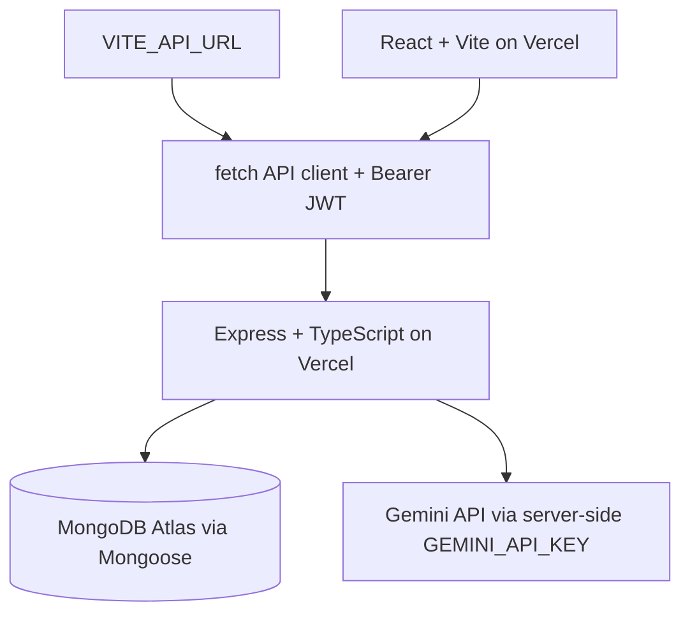

[](https://github.com/jhenellealonzo/itelect4-project/actions/workflows/ci.yml)

# Campus Lost & Found Tracker

The Campus Lost & Found Tracker helps campus users browse reported items, view item details, submit claims, and review the quality of a lost-or-found report with AI feedback.

## Features

- Public dashboard and item catalogue.
- Item detail pages for lost, found, and claimed items.
- User registration and login with a Bearer JWT session.
- Authenticated claim workflow.
- Protected **AI Report Review** page that returns a structured summary, key details, suggestions, and readiness assessment.

The main domain entities are:

- **User** — a student or security administrator who can authenticate and own or claim items.
- **Item** — a lost or found object with a description, location, date, status, and owner.
- **Claim** — a user's proof-backed request to claim an item.

## Routes

The current frontend routes are:

| Route | Purpose | Access |
| --- | --- | --- |
| `/` | Dashboard | Public |
| `/items` | Browse items | Public |
| `/items/:id` | View one item | Public |
| `/login` | Sign in | Public |
| `/register` | Create an account | Public |
| `/claims` | View and manage claims | Protected |
| `/review` | AI Report Review | Protected |

## Technology and architecture

This frontend uses React, TypeScript, and Vite. Styling uses Tailwind CSS through the Tailwind Vite plugin, with reusable UI components and Lucide icons. TanStack Query handles server-state mutations and queries. The API client uses `fetch` and attaches the current Bearer JWT to authenticated requests.



`VITE_API_URL` is the frontend API-base configuration. It should be the backend base URL without a trailing slash or `/api` suffix.

## Local development

Requirements: Node.js 24 (Node.js 22.12 or newer is also supported by the project requirements) and npm.

```bash
npm install
copy .env.example .env
npm run dev
```

Set the local `.env` value to the backend base URL:

```env
VITE_API_URL=http://localhost:4000
```

The backend must be running separately for item, claim, authentication, and AI requests. Do not commit `.env` or any secret values.

## Testing and production build

Vitest runs the three focused frontend test categories: the `ItemCard` component, the `useToggle` custom hook, and `LoginPage` client-side validation. Tests use a test-only API URL from `vite.config.ts`, so they do not require a running backend or the local `.env`.

```bash
npm test
npm run lint
npm run build
```

The production build is written to `dist/` and can be previewed with `npm run preview`.

## Deployment

The verified current deployments are:

- Frontend: [itelect4-project-cyan.vercel.app](https://itelect4-project-cyan.vercel.app)
- Backend: [itelect4-backend-theta.vercel.app](https://itelect4-backend-theta.vercel.app)

## AI-use disclosure

AI tools were used as development assistants for selected code review, testing/CI guidance, and documentation tasks. The final implementation remains subject to the student's own review, testing, and explanation.
